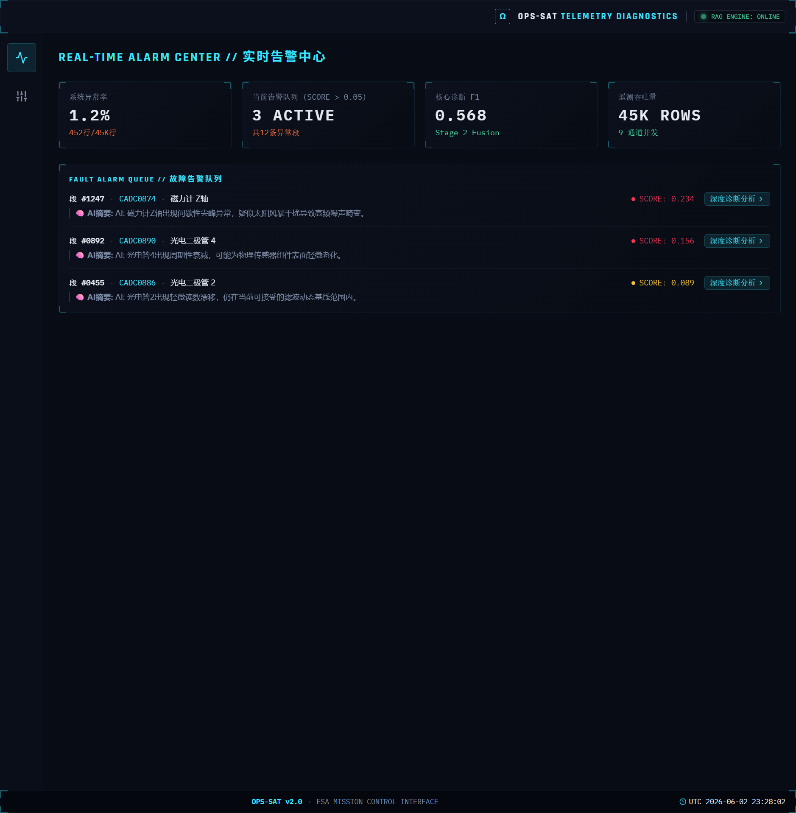
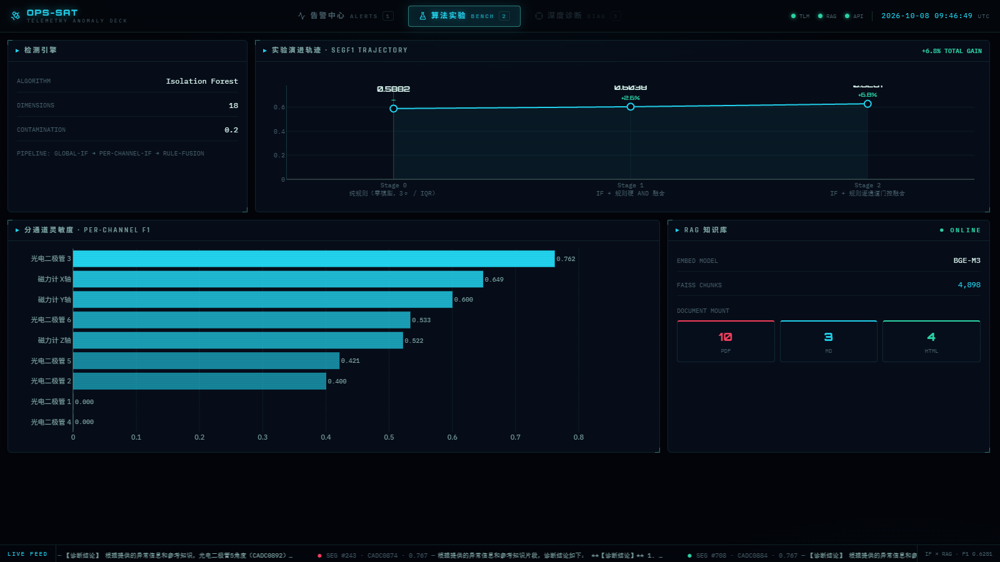
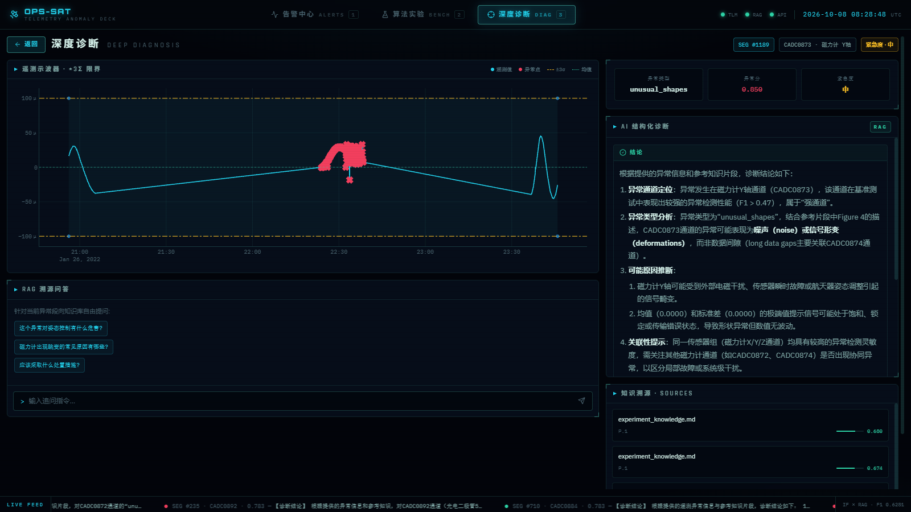

# Microsatellite Telemetry Anomaly Detection & RAG Explanation System

<p align="right"><b>English</b> | <a href="README.md">中文</a></p>

> Shanghai Dianji University · 3-Person Undergraduate Innovation Project (in exchange with the Innovation Academy for Microsatellites, CAS)

<p align="center">     </p>

Built for weakly-labeled, high-reliability spacecraft telemetry diagnostics using the public **ESA OPS-SAT-AD** real on-orbit dataset (`303,493` samples / `2,123` segments / `9` channels). The system decouples **deterministic per-channel detection** (local) and **local hybrid RAG retrieval** from **on-demand DeepSeek API explanations** with PDF page-level traceability.

<p align="center">  </p>

## Verified Results

| Dimension | Measured Result | Notes |
|---|---|---|
| **Strict Segment-level CV F1** | **0.35 → 0.57** | 3-fold nested leak-free CV without Point-Adjustment inflation; frozen benchmark (`a02-engineering-gate-v1`) **0.6204** |
| **Local Hybrid Retrieval (BM25 + FAISS)** | **MRR 0.885** / ~**20ms** | **4,863** handbook chunks preserving full telemetry IDs; 24-query ablation dropped ~0.5s Cross-Encoder reranking & rank-hurting RRF |
| **300k-Point Stream Replay** | Synthetic Alert Push **P95 494ms** | FastAPI + WebSocket replay skipping empty gaps; **SQLite transactional lease lock (WAL)** prevents concurrent duplicate LLM calls |
| **Fact Audit & Hallucination Guard** | **10/10 Refusal** (Factuality **1.90/2.0**) | Audited source papers, quarantined **200 legacy cached records**, and verified 30 real answers via LLM-as-a-Judge |
| **Verification & Delivery** | **445 pytest** + **35 Browser E2E** | Paired with 20 frontend unit tests, Windows launcher script, and **SHA-256** delivery integrity manifest |

## Quick Start

```bash
git clone -b main https://github.com/Jerry518520/microsat-anomaly-analysis.git
cd microsat-anomaly-analysis
python scripts/start_ui.py
```

Open `http://localhost:5180`. Detection and local retrieval run fully locally; set `DEEPSEEK_API_KEY` in `.env` for on-demand LLM explanations. See `DEPLOY.md` and `API.md` for full setup details.
