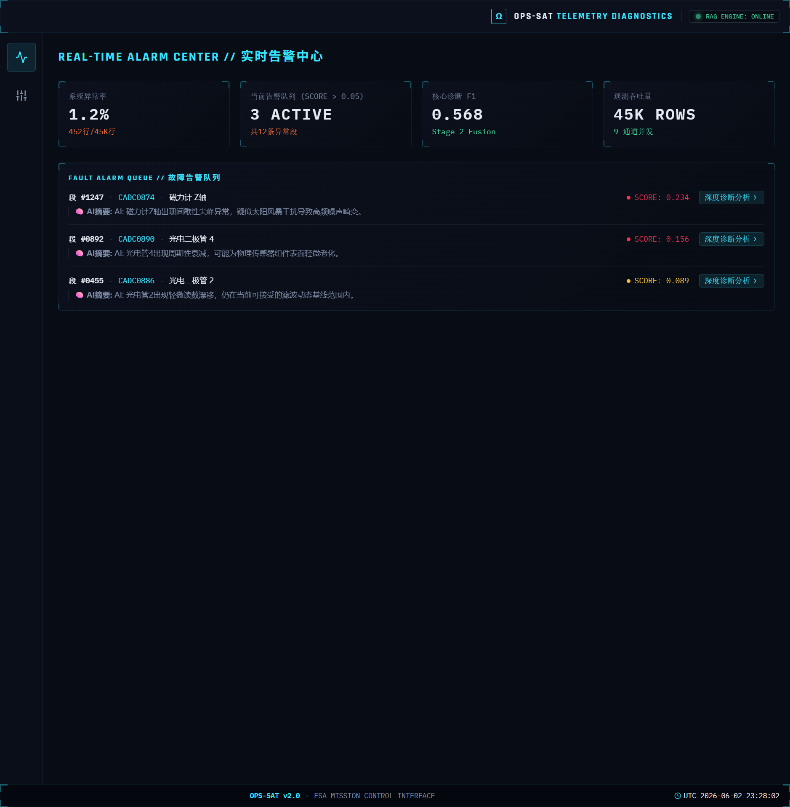
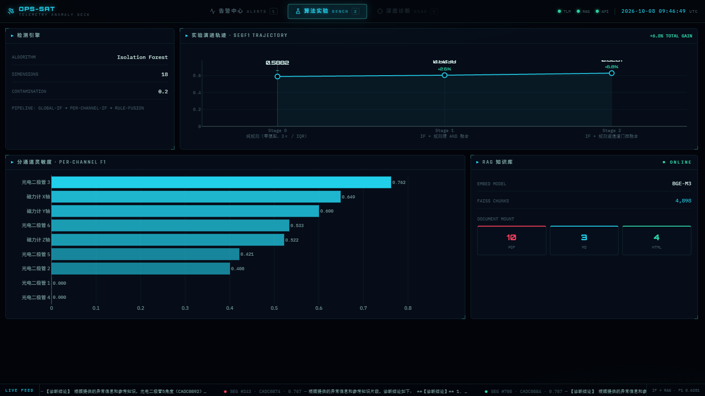
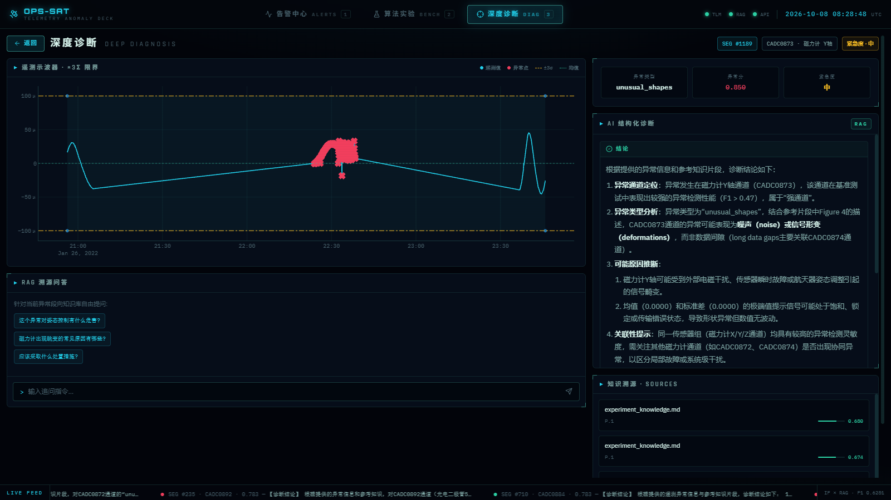

# 微小卫星遥测异常检测与 RAG 解释系统

<p align="right"><a href="README.en.md">English</a> | <b>中文</b></p>

> 上海电机学院 · 3 人大学生创新创业训练计划项目（中科院小卫星所交流项目）

<p align="center">     </p>

面向缺标注、高可靠的航天遥测场景，系统采用**“确定性分通道异常检测 + 本地混合 RAG + 按需调用 DeepSeek API 解释”**架构：先用分通道 18 维规范特征与规则/孤立森林门控稳定检出异常段（不做 Point-Adjustment 刷分，残缺段显式拒判），再检索本地航天手册知识库，按需生成带 PDF 原文页码定位的故障诊断解释。

**公开数据基准**：基于欧洲航天局公开真实在轨立方星数据集 **ESA OPS-SAT-AD** —— `303,493` 采样点 / `2,123` 段 / `9` 通道（段级异常占比 `20.44%`，点级 `33.04%`，两套分母严格隔离）。

<p align="center">  </p>

## 实测验收结果

| 维度 | 实测结果 | 说明 |
|---|---|---|
| **严格段级交叉验证 F1** | **0.35 → 0.57** | 3 折嵌套无泄漏 CV，拒用 Point-Adjustment 刷分；工程冻结包（`a02-engineering-gate-v1`）529 段基准复核 **0.6204** |
| **本地混合检索（BM25 + FAISS）** | **MRR 0.885** / 约 **20ms** | 6 类公开航天手册切分 **4,863 块**（保留完整遥测编号）；24 题实验果断砍掉耗时 494ms 的 Rerank 与拉低效果的 RRF |
| **30 万点流式回放** | 告警推送 **P95 494ms** | FastAPI + WebSocket 跳过空白时段全量回放；**SQLite WAL 防重锁**避免同一异常并发重复调用 LLM |
| **防幻觉与事实核查** | **10/10 准确拒答**（一致性 **1.90/2.0**） | 核验原论文确认磁力计轴向/单位未公开，隔离 **200 条存疑历史缓存**并补充边界文档；30 题真实问答经 LLM-as-a-Judge 复核 |
| **测试与可复现交付** | **445 项 pytest** + **35 项浏览器验收** | 配套 20 项前端单测、Windows 一键启停脚本与交付文件 **SHA-256 完整性校验清单** |

## 技术架构与边界

```
┌───────────────────────────────────────────────────────┐
│            前端  React 19 + TypeScript                │
│   实时告警看板 · 检测分析 · 深度诊断（原文页直达）    │
└───────────────────────────────────────────────────────┘
                          │  REST + WebSocket（X-API-Key 鉴权 / 限流）
                          ▼
┌───────────────────────────────────────────────────────┐
│                FastAPI 后端 + SQLite WAL              │
│   会话幂等接入 · 实时闭段判定 · 解释防重锁与持久化    │
└───────────────────────────────────────────────────────┘
                          │
        ┌─────────────────┴─────────────────┐
        ▼                                   ▼
 确定性检测（纯本地）                混合检索与解释
 · 18 维规范特征（离/在线共享）      · 本地 BGE-M3 + FAISS + BM25（4,863 块）
 · 分通道规则 + 孤立森林门控         · 按需调用 DeepSeek API（双模板 + 页码溯源）
 · 残缺段标 incomplete 拒判          · 低分拒答与事实边界知识库
```

| 层次 | 技术与边界说明 |
|---|---|
| **前端** | React 19 + TypeScript + Vite + Tailwind CSS + Plotly / ECharts |
| **后端与流控** | FastAPI + Uvicorn（REST / WebSocket）、API 鉴权与限流、SQLite WAL 事务防重锁 |
| **异常检测（纯本地）** | 分通道 18 维规范特征 + 规则/孤立森林门控融合（`a02-engineering-gate-v1`） |
| **混合检索（纯本地）** | 本地 `BGE-M3` + `FAISS` + 自研 `BM25`（保留遥测编号），无云端解析依赖 |
| **按需解释（云端 API）** | 按需调用 `DeepSeek API`，拆分为通用直答与事件诊断双模板，支持 PDF 原文页定位 |
| **验证与交付** | 445 项 `pytest` + 20 项 `node:test` + 35 项 Headless Chrome CDP E2E + SHA-256 完整性校验清单 |

## 快速启动

```bash
git clone -b main https://github.com/Jerry518520/microsat-anomaly-analysis.git
cd microsat-anomaly-analysis
python scripts/start_ui.py
```

启动后访问 `http://localhost:5180`。异常检测与本地检索完全离线运行；按需生成 LLM 解释需在 `.env` 配置 `DEEPSEEK_API_KEY`。详细部署与依赖说明见 `DEPLOY.md` 与 `API.md`。

## 关键工程决策与复盘

1. **靠实测做减法**：航天手册含大量专有传感器编号且需把检索压在 20ms 级，24 题对照实验发现常见 RRF 融合反而拉低排序、Cross-Encoder Rerank 耗时 494ms 且无净收益，遂果断舍弃，通过文档扩充与轻量加权实现 MRR 0.885。
2. **排查静默失效与事实边界**：定位并修复 `system_prompt: ""` 导致防幻觉系统提示词静默失效的缺陷；逐页核验原始论文确认磁力计轴向/单位未公开后，果断隔离 200 条存疑历史缓存并写入边界文档，实现 10/10 资料不足题准确拒答。
3. **双模板防偏题与错引**：针对普通问答误套故障诊断模板导致偏题、转述摘要导致错引页码的问题，拆出通用直答与事件诊断双模板并强制绑定原文片段索引直达 PDF 原页。

## 团队与分工

| 成员 | 角色 | 核心负责模块 |
|---|---|---|
| **李冰杰** | 核心负责人 | 分通道异常检测算法与评测、本地混合 RAG 与防幻觉治理、FastAPI + WebSocket + SQLite WAL 后端、全链路测试验收与交付清单 |
| 王翌钧 | 成员 | 数据清洗脚本与 React 19 前端可视化工作台 |
| 陶诗怡 | 成员 | 公开航天知识库资料整理与文档校对 |
